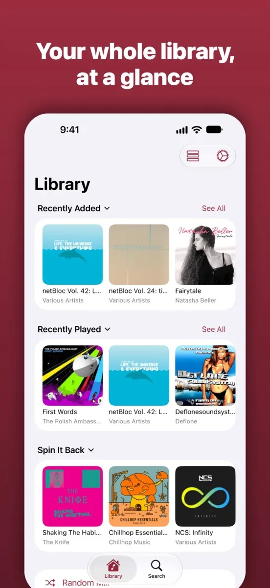
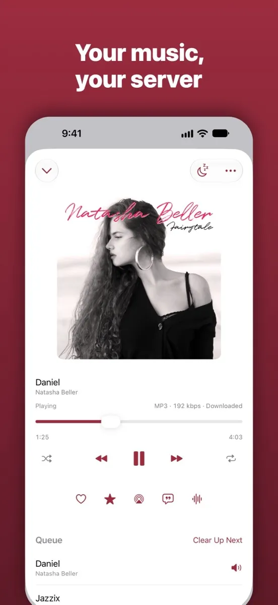
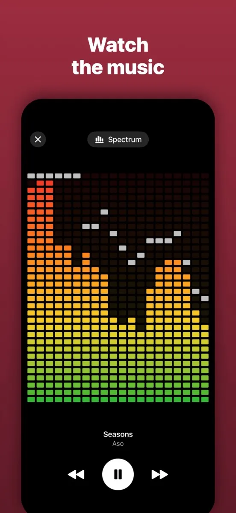

# Bzide

A native iPhone and iPad music player for your own [Navidrome](https://www.navidrome.org) server.

[**Bzide on the App Store**](https://apps.apple.com/app/bzide/id6825602899) · [Website and user guide](https://bzide.hillcraft-sc.com)

No server yet? Tap **Try the Demo** on the sign-in screen to explore a sample library hosted by the Navidrome project.

  
  
  

## Why

Existing Navidrome clients felt clunky and unreliable on iOS, with weak CarPlay and widget support. Bzide puts playback first: it should work every time, with the screen locked, on a call, or when the network changes.

## What it does

- Gapless playback, background and lock screen controls, interruptions and route changes handled, a queue that survives relaunch, correct scrobbling
- Offline downloads, with streaming and download quality per connection
- CarPlay, Home Screen and Lock Screen widgets, a Control Center control, Siri
- Favorites, ratings, playlists, search with filters, random and rated mixes, Spin Off from any song or artist
- Synced lyrics, internet radio, an equalizer, a sleep timer
- Music visualizers and themes (Catppuccin, Gruvbox, Nord, Dracula, Tokyo Night)
- Private by design: your login stays in the Keychain, no analytics, no third-party code, and every outside service is off until you turn it on

[`docs/USER-GUIDE.md`](docs/USER-GUIDE.md) covers everything, and [`docs/PRIVACY.md`](docs/PRIVACY.md) says exactly what is sent where.

## How it is built

Swift, SwiftUI and Swift concurrency, iOS 27 and later, Apple frameworks only.

- `MusicApp/`: the app. Views display state and forward intent; nothing else lives there.
- `Packages/NavidromeCore/`: the portable core (Subsonic and OpenSubsonic client, playback engine, queue, downloads, caching), free of UI frameworks and tested without a device or a server.
- `BzideControls/`: the widgets and controls extension.
- [`docs/BEHAVIOR.md`](docs/BEHAVIOR.md): the behavior spec, written so a web or Android client can be ported from it.

### Building

You need Xcode 27 with its Metal Toolchain (Xcode > Settings > Components, or `xcodebuild -downloadComponent MetalToolchain`).

1. Open `MusicApp.xcodeproj`.
2. Under Signing & Capabilities, choose your own team, and change the bundle identifiers and the App Group (`group.com.erichebert.musicapp`) to ones you own. CarPlay audio and WeatherKit need entitlements from Apple, which you'd request for your own app; without them, remove those entitlements to build.
3. Run on a device or Simulator.

Tests: ⌘U on the `MusicApp` scheme for the app, and on the `NavidromeCore` scheme (open `Packages/NavidromeCore/Package.swift` on its own) for the core. Integration tests against a real server run only when `NAVIDROME_URL`, `NAVIDROME_USER` and `NAVIDROME_PASSWORD` are set; see [the build-and-test notes](.claude/skills/build-and-test/SKILL.md).

## Contributing

Bug reports and ideas are welcome as [issues](https://github.com/hillcraft-sc/bzide/issues/new/choose). For a code change, please open an issue first so we can agree on it before you write it; [CONTRIBUTING.md](CONTRIBUTING.md) has the details. For a security problem, see [SECURITY.md](SECURITY.md).

## License

The code is under the [GNU General Public License v3.0](LICENSE). The name **Bzide**, the icon and the website's branding are not; see [`TRADEMARK.md`](TRADEMARK.md). If you publish a fork, including on the App Store, give it a different name and icon.

Bzide is not affiliated with the Navidrome project.
